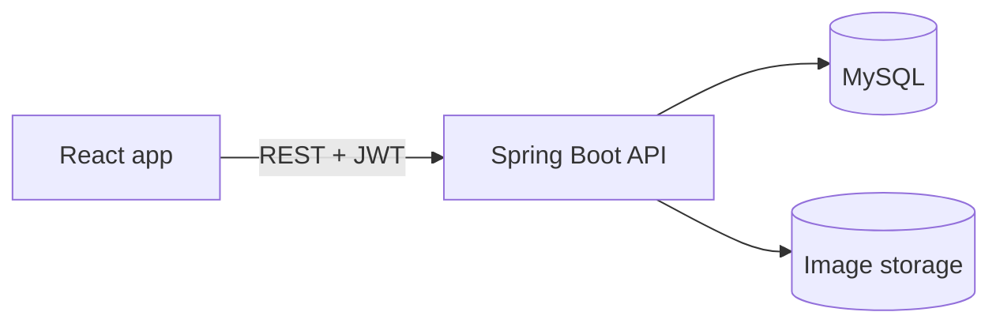
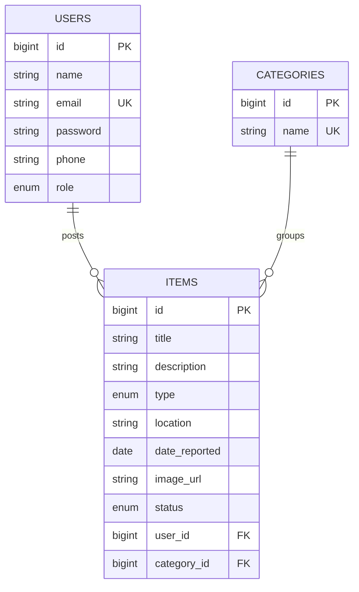

# CampusFind

A lost-and-found platform for college campuses. Students report lost or found items with photos, browse and search what others have posted, and contact the poster. Admins review every post before it goes public.

**Live demo:** coming soon

## Features

**Students**
- Register and log in with JWT authentication
- Report a lost or found item with category, place, date and an optional photo, with a live preview
- Browse approved items with search, type filter, category filter and location filter
- Contact details are visible only to logged-in users
- Edit, delete or mark your own posts as claimed

**Admins**
- Dashboard with post counts by status
- Review queue: approve or reject each new post
- Delete inappropriate posts

## Tech stack

| Layer | Technology |
|---|---|
| Frontend | React, Vite, Tailwind CSS, React Router, Axios |
| Backend | Java 21, Spring Boot, Spring Security, Spring Data JPA |
| Database | MySQL |
| Auth | JWT (stateless), BCrypt password hashing |
| Image storage | Local disk in development |

## Architecture



## Database



## API overview

| Method | Endpoint | Access |
|---|---|---|
| POST | `/api/auth/register`, `/api/auth/login` | Public |
| GET | `/api/items` (filters: type, categoryId, keyword, location) | Public, contact details hidden |
| GET | `/api/categories` | Public |
| GET | `/api/items/{id}` | Logged in |
| POST | `/api/items` | Logged in |
| GET | `/api/items/my` | Logged in |
| PUT, DELETE | `/api/items/{id}` | Owner (admin can delete) |
| PATCH | `/api/items/{id}/claim` | Owner |
| POST | `/api/files/upload` | Logged in |
| GET | `/api/admin/pending`, `/api/admin/stats` | Admin |
| PATCH | `/api/admin/items/{id}/approve`, `/reject` | Admin |

## Design decisions

- **Moderation workflow:** posts start as `PENDING` and only appear publicly after an admin approves them. Editing a post sends it back for review.
- **Privacy:** the public list never includes the poster's email or phone. Only logged-in users see contact details, on the item page.
- **Security:** BCrypt hashing, stateless JWT, role-based access rules on the server, and no admin sign-up through the API.
- **Search:** filters are built dynamically with JPA Specifications, so every filter is optional.
- **Validation:** request DTOs are validated, and a global exception handler returns clear JSON errors.
- **Uploads:** only JPG, PNG and WEBP up to 5 MB, saved under random names.

## Run locally

Requirements: Java 21, Node 20 or newer, MySQL 8.

1. Create the database in MySQL:

```sql
CREATE DATABASE campusfind_db;
```

2. Create `backend/src/main/resources/local.properties` (it is git-ignored):

```properties
spring.datasource.password=YOUR_MYSQL_PASSWORD
jwt.secret=ANY_RANDOM_STRING_OF_AT_LEAST_32_CHARACTERS
```

3. Start the backend (runs on http://localhost:8081):

```bash
cd backend
./mvnw spring-boot:run
```

4. Start the frontend (runs on http://localhost:5173):

```bash
cd frontend
npm install
npm run dev
```

5. Register an account on the site, then make it an admin in MySQL:

```sql
UPDATE users SET role = 'ADMIN' WHERE email = 'your@email.com';
```

Log out and log in again to see the Admin dashboard.

## Roadmap

- Cloud image storage and live deployment
- Automated tests for the API
- Email notification when a post is approved

## Author

Priyadarshan S | [GitHub](https://github.com/priyadarshan2317)